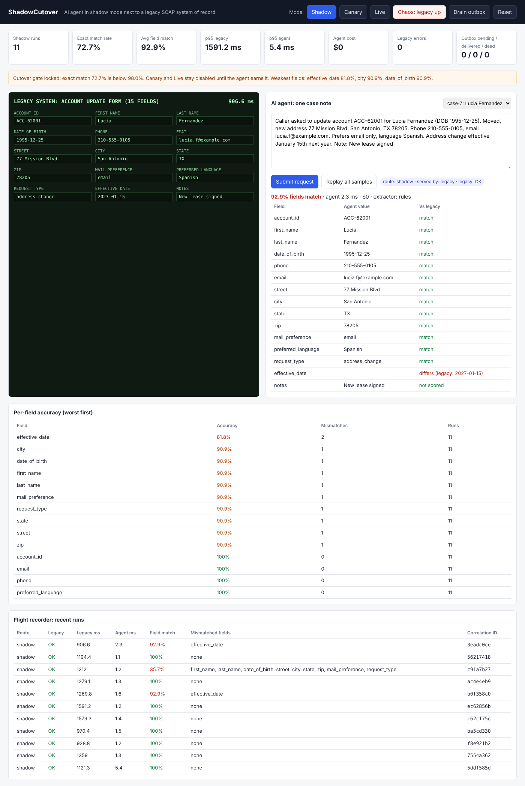
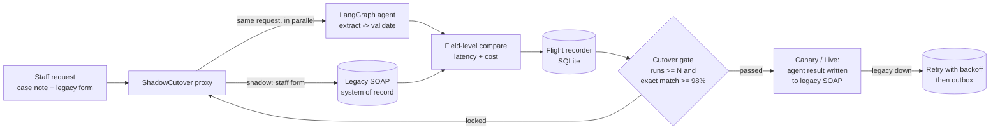

# ShadowCutover

**Run an AI agent in shadow mode next to a legacy system of record, measure it field by field, and only let it take over once it has earned it.**

Agencies, banks and hospitals still run core workflows on SOAP services and 15-field green-screen forms. Putting an AI agent in front of those systems is risky: a wrong write goes straight into the system of record. ShadowCutover is a small proxy that lets the agent work on real requests **without touching anything** until the numbers say it is safe.



## How it works



| Mode | Who serves the user | What the agent does |
|---|---|---|
| **Shadow** | Legacy path, exactly as today | Processes the same request in parallel; its result is only recorded and compared |
| **Canary** | Agent for `CANARY_PCT`% of requests | Writes its result to the legacy SOAP service for that slice |
| **Live** | Agent | Writes every validated result; invalid results go to human review |

Canary and Live are **locked** until the cutover gate passes. The UI and the API both refuse to switch early.

## Features

- **Dual-run shadow proxy** in FastAPI: legacy and agent run on the same request concurrently, with a shared correlation ID.
- **Mock legacy system** that speaks SOAP 1.1 (`UpdateAccount` envelope, SOAP faults, 0.9 to 1.6 s latency).
- **LangGraph agent** (`extract -> validate`). Uses an LLM when `OPENAI_API_KEY` is set, otherwise a deterministic rule-based baseline so the demo runs with no keys and no cost.
- **Field-level comparison** with normalization (phone digits, case, whitespace) so formatting noise is not counted as an error.
- **Flight recorder**: every run stored with legacy status, p95 latency on both paths, agent cost, mismatched fields and validation issues.
- **Cutover gate**: minimum run count and exact-match threshold, both configurable.
- **Chaos toggle**: takes the legacy host down. In Shadow mode users see the same failure they would see today. In Live mode the agent retries with exponential backoff and then queues the write to an outbox instead of losing it.
- **Safety rule**: the agent never writes a form that failed validation, even in Live mode.

## Run it

```bash
python -m venv .venv && source .venv/bin/activate
pip install -r requirements-dev.txt
uvicorn app.main:app --port 7860
# open http://localhost:7860
```

Replay the sample cases and print the shadow report:

```bash
python scripts/replay.py --url http://localhost:7860
```

Run the tests:

```bash
pytest -q
```

Use an LLM extractor instead of the rule baseline:

```bash
export OPENAI_API_KEY=...            # optional
export OPENAI_MODEL=gpt-4o-mini       # optional
export PRICE_PER_1K_TOKENS=0.0006     # used for the cost column
```

Point at a real legacy SOAP host instead of the built-in mock:

```bash
export LEGACY_URL=https://legacy.example.internal
```

## Configuration

| Variable | Default | Meaning |
|---|---|---|
| `CUTOVER_MIN_RUNS` | 10 | Shadow runs required before the gate can open |
| `CUTOVER_THRESHOLD` | 98 | Exact-match % required to unlock Canary and Live |
| `CANARY_PCT` | 10 | Share of requests routed to the agent in Canary mode |
| `SHADOW_DB` | `shadow_runs.db` | SQLite file for the flight recorder |

## Results

Shadow report from `scripts/replay.py` on the 10 bundled sample cases with the **rule-based baseline** extractor (no LLM):

| Metric | Value |
|---|---|
| Shadow runs | 10 |
| Exact match rate | 80.0% |
| Avg field match | 92.9% |
| p95 legacy latency | 1,507.6 ms |
| p95 agent latency | 3.9 ms |
| Cutover gate | Locked (80.0% < 98%) |

The two misses are useful: one note gives the effective date in words ("January 15th next year") and one uses a different sentence pattern ("Spoke with Tom Hale, acct ..."). That is exactly the kind of gap shadow mode is meant to surface before cutover.

> Replace this table with your own numbers after running with an LLM extractor.

## Project layout

```
app/
  main.py        FastAPI app, API routes, dashboard
  shadow.py      shadow proxy, comparison, cutover gate, retry + outbox
  agent.py       LangGraph agent (LLM or rule-based extractor + validation)
  legacy.py      mock SOAP system of record with chaos switch
  store.py       SQLite flight recorder and summary metrics
  fields.py      15-field form definition and normalization
  static/        split-screen dashboard
data/sample_cases.json
scripts/replay.py
tests/
```

## Deploy to Hugging Face Spaces

Create a new Space with the **Docker** SDK, push this repo to it, and it will start on port 7860 using the included `Dockerfile`.

## Roadmap

- Per-field confidence and a per-workflow cutover gate (address changes can go live before name changes)
- Replay of historical traffic from logs, not just live requests
- Outbox drain worker that replays queued writes when the legacy host recovers
- Export of the shadow report as a sign-off PDF for client stakeholders

## License

MIT
